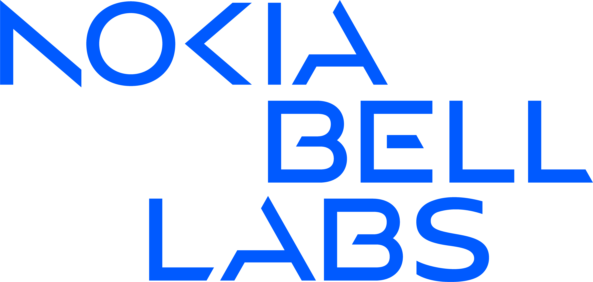

# Nokia Bell Labs

## What is in this organization?

This GitHub organization is the home for research projects we create in Nokia Bell Labs or in Nokia. The projects in
this organization are not intended for commercial use and many times appendixes for scientific publications, therefore
unmaintained. Repositories in this organization do not have an open source steward as it is defined in the
European Union [Cyber Resilience Act Article 3(14)](https://eur-lex.europa.eu/legal-content/EN/TXT/HTML/?uri=OJ:L_202402847#art_3).
