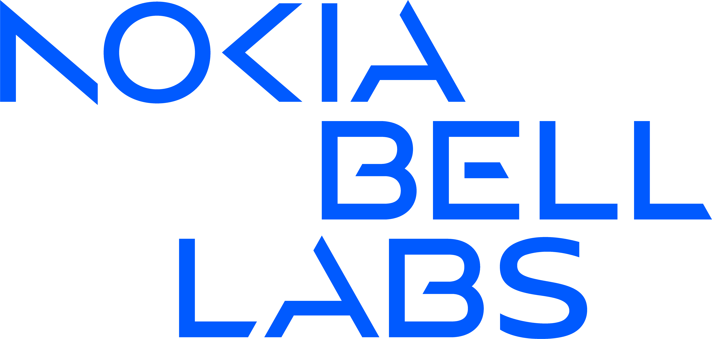

# Nokia Bell Labs

## What is in this organisation?

This GitHub organisation is the home for research projects we create in Nokia Bell Labs or in Nokia. The projects in
this organisation are not intended for commercial use and many times appendixes for scientific publications, therefore
unmaintained. Repositories in this organisaiton do not have an open source steward as it is defined in the
European Union Cyber [Resliliency Act Article 3(14)](https://eur-lex.europa.eu/legal-content/EN/TXT/HTML/?uri=OJ:L_202402847#art_3).

## What is not in this organisation?

We have some strategic open source initiatives which has their own organisations. Couple of examples:

* [Nokia-Bell-Labs](https://github.com/Nokia-Bell-Labs): Contains code related to publications by Nokia BellLabs
* [kubenet-dev](https://github.com/kubenet-dev): We created the Kubenet community with the goal to help network
  engineers understand the potential of Kubernetes for network automation.
* [kuidio](https://github.com/kuidio): Kubernetes identifiers (kuid)
* [kform-dev](https://github.com/kform-dev): Kubernetes form templates (KForm)
* [sdcio](https://github.com/sdcio): Schema Driven Configuration